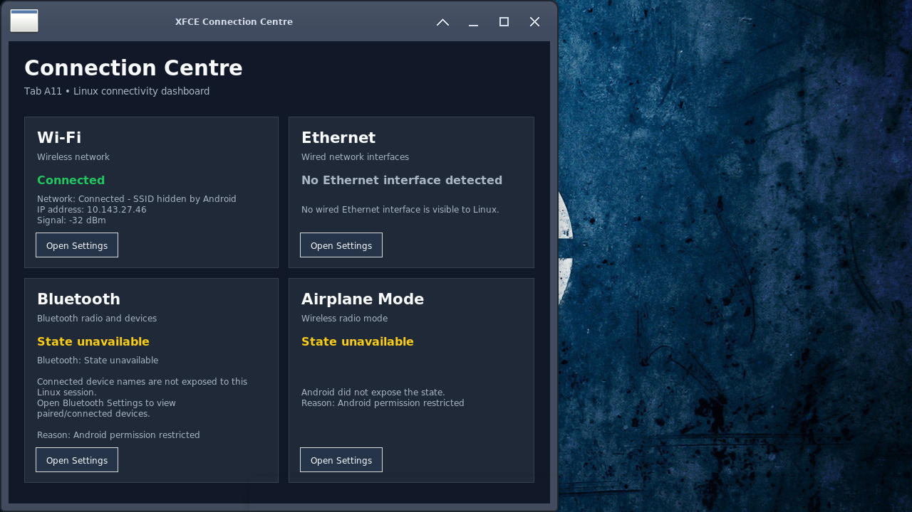

# XFCE Connection Centre

A lightweight Android and Linux connectivity dashboard built with Python and Tkinter.

Designed for Android tablets running Linux desktop environments through Termux and Proot.

## Features

- Wi-Fi status monitoring
- Bluetooth status monitoring
- Ethernet interface detection
- Airplane Mode status
## Dashboard Preview


The application monitors connectivity. It does not directly enable or disable Android radios.

## Requirements

- Python 3
- Tkinter
- XFCE or another X11 desktop environment
- Android / Termux / Proot environment

Optional system commands:

- ip or ifconfig
- bluetoothctl
- termux-wifi-connectioninfo
- Android am and settings

No third-party Python packages are required.

## Installation

Clone using HTTPS:

```bash
git clone https://github.com/Cnvalvi/XFCE-Connection-Center.git
cd XFCE-Connection-Center
```

Or clone using SSH:

```bash
git clone git@github.com:Cnvalvi/XFCE-Connection-Center.git
cd XFCE-Connection-Center
```

On Debian or Ubuntu, install dependencies:

```bash
sudo apt update
sudo apt install python3 python3-tk
```

Install the application:

```bash
chmod +x install.sh
./install.sh
```

Open XFCE Applications Menu and find XFCE Connection Centre.

## Run Without Installing

```bash
python3 connection_centre.py
```

## Uninstallation

From the project directory:

```bash
chmod +x uninstall.sh
./uninstall.sh
```

Uninstallation removes the installed application and menu launcher. It does not delete the cloned project directory.

## Project Structure

```text
XFCE-Connection-Center/
├── connection_centre.py
├── install.sh
├── uninstall.sh
├── launch.sh
├── xfce-connection-centre.desktop
├── icon.svg
├── README.md
├── LICENSE
├── requirements.txt
└── .gitignore
```

## Platform

Developed for Android-based Linux desktop environments using Termux, Proot and XFCE.

Compatibility depends on Android permissions, available system commands and desktop environment configuration.

## Developer

Cnvalvi

https://github.com/Cnvalvi

## License

MIT License. See LICENSE.
