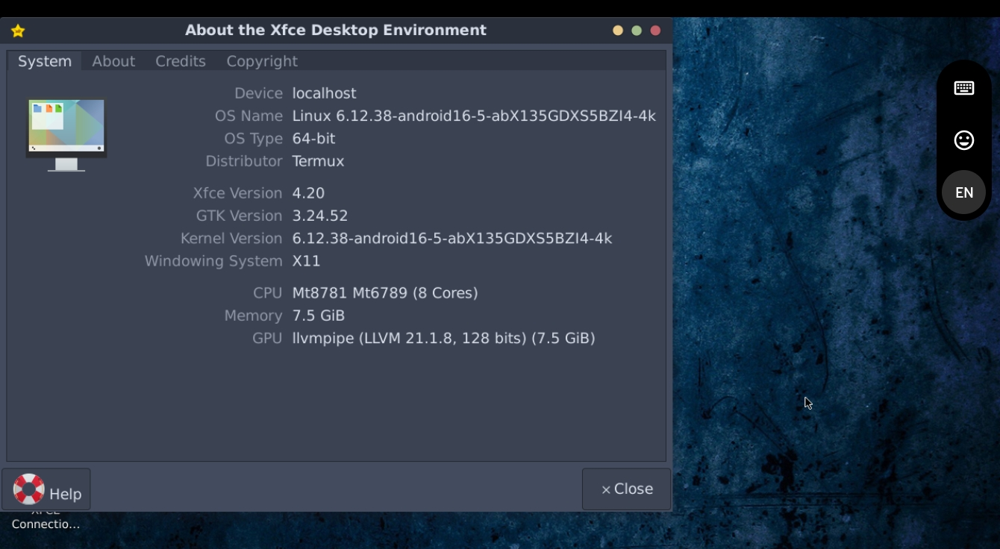
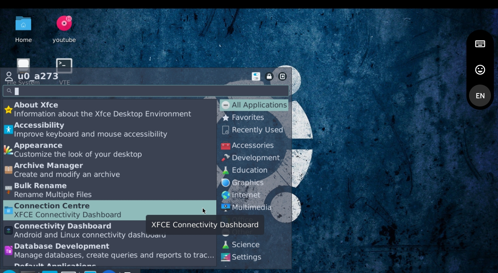

# XFCE Connection Centre

Short project description

---

# Features

- Wi-Fi Status Monitoring
- Bluetooth Status Detection
- Ethernet Interface Detection
- Airplane Mode Detection
- Android Settings Shortcuts
- Manual Refresh
- Background Status Updates
- Last Update Indicator
- XFCE Applications Menu Integration

---

# What This Project Does

Explain what the application actually does.

---

# What This Project Does NOT Do

- Does not install Termux
- Does not install Debian/Ubuntu
- Does not install XFCE
- Does not install VNC
- Does not install Termux:X11
- Does not enable/disable Android radios

---

# Screenshot

## Screenshots of the Application

### 1. Main Dashboard


### 2. Termux environment


### 3. All Applicant View

---

# Fresh Android Setup Guide

## Step 1 - Install Termux

## Step 2 - Install Debian

## Step 3 - Install XFCE Desktop

## Step 4 - Configure Graphical Environment

## Step 5 - Verify Required Components

---

# Recommended Environment

```text
Android Device
│
├── Termux
│
├── Proot-Distro
│
├── Debian / Ubuntu
│
├── XFCE Desktop
│
├── Termux:X11 or VNC
│
└── XFCE Connection Centre
```

---

# System Requirements

Minimum requirements.

---

# Required Dependencies

Required:

```text
python3
python3-tk
iproute2
```

Recommended:

```text
net-tools
bluetooth
```

---

# Installation

```bash
git clone ...
cd XFCE-Connection-Center
chmod +x install.sh
./install.sh
```

---

# Verify Before Installing

```bash
python3 connection_centre.py
```

Expected result:

- Application window opens
- No Python errors
- Connectivity status visible

If this fails, fix dependencies before running the installer.

---

# Dependency Verification

Explain what install.sh checks.

Example:

```text
python3
tkinter
ip command
required project files
```

---

# Tested Devices

| Device | Status |
|----------|----------|
| Samsung Galaxy Tab | ✅ Tested |

The project has primarily been tested on:

- Android
- Termux
- Debian
- XFCE

Compatibility with other environments is not guaranteed.

---

# Troubleshooting

## tkinter not found

## ip command not found

## ifconfig not found

## Bluetooth not detected

## No graphical display

## Android feature limitations

---

# Known Limitations

- Depends on available Android commands
- Bluetooth support varies by device
- Android manufacturers may restrict access
- Some features may not work inside every Proot environment

---

# Uninstallation

```bash
chmod +x uninstall.sh
./uninstall.sh
```

---

# Project Structure

```text
XFCE-Connection-Center
├── connection_centre.py
├── install.sh
├── uninstall.sh
├── launch.sh
├── xfce-connection-centre.desktop
├── icon.svg
├── README.md
├── requirements.txt
├── LICENSE
└── .gitignore
```

---

# Roadmap

- [ ] Dark Mode
- [ ] Battery Status
- [ ] VPN Detection
- [ ] Mobile Data Detection
- [ ] Network Usage Statistics
- [ ] Better Android Integration

---

# Contributing

Contribution instructions.

---

# License

MIT License

---

# Author

Cnvalvi

GitHub:
https://github.com/Cnvalvi
